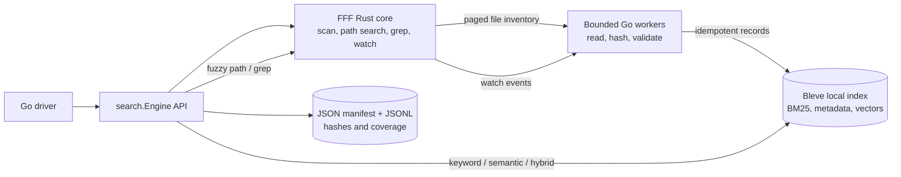

# Architecture

## Product boundary

This repository is an in-process local search library. It has no agent orchestration, prompts, model lifecycle, database server, filesystem mutation/organization, or compatibility layer for the removed product.

### Ownership

- **FFF (`fff-search` 0.11.0)** owns filesystem traversal/indexing, ignore policy, fuzzy file-path search, grep, and filesystem watch events. Go does not run another tree walk. A thin Rust `cdylib` bridge exposes inventory pages and events from FFF's Rust API.
- **Bleve 2.6.0** owns the local persisted text, metadata, and vector index. There is one Bleve index for file and caller-provided documents.
- **Go `search` package** owns stable IDs, content reading, size/binary policy, SHA-256 evidence, bounded event workers, Bleve writes/query plans, exact metadata filters, vector version checks, and status/reporting.
- **Drivers** own embedding generation. A driver obtains `VectorInput` work from `MissingVectors`, calculates a vector using its chosen local model, and calls `UpsertVectors` with the expected content hash.

The Go API is the supported boundary. Rust/FFF types, Bleve types, and C pointers do not cross that boundary.

## Corpus and identities

`SyncFiles` waits for FFF's initial scan and watch subscription, then pages FFF's indexed file list. Go opens each relative path through `os.OpenRoot`, enforces the configured maximum file size, rejects NUL-containing/binary/non-UTF-8 content, computes SHA-256, and submits one Bleve document per eligible file.

File IDs are deterministic hashes of normalized root-relative paths under the reserved `file:` prefix. Caller record IDs are caller-owned and may not use that prefix. Paths and IDs are both stored as evidence locators; a rename creates a new file ID and deletes the old FFF-owned document.

The current model indexes one document per file; it does **not** chunk large documents or parse PDFs/Office formats. Add chunking/extraction only after the corpus and relevance tests define boundaries and result citation semantics.

## Updates and consistency

FFF emits debounced create/modify/remove/rename/rescan events. Go copies these into a bounded queue, coalesces repeated paths, and applies idempotent Bleve writes. Queue overflow, unsupported event paths, or a rescan event triggers a full FFF-inventory reconciliation.

Startup/full synchronization is page-driven. File reads are limited to the configured worker count and maximum file size; only a small inventory page and bounded in-flight file contents are resident outside FFF/Bleve. Each file document is tagged with a sync generation. Stale records are pruned only after a full successful scan. A read failure preserves the previous searchable record as stale and is recorded in the evidence JSONL.

The index and FFF catalog do not share a transaction. Freshness is eventually consistent and observable through `Status`, `BuildReport`, stale hit state, vector availability, and evidence artifacts. A changed file invalidates its old vector; `UpsertVectors` checks the expected content hash and rejects vectors computed for prior content.

## Query lanes

| Lane | Engine | Behavior |
|---|---|---|
| Fuzzy file path | FFF | Path/name matching and FFF-specific ranking. |
| Content grep | FFF | Plain, regex, or fuzzy match with source line/offset evidence. `Limit` is a match target and may overshoot by at most the per-file match cap; use `NextFileOffset` to continue. Context and returned line bytes are bounded. |
| Keyword | Bleve | Fielded full text over title, text, and context. Metadata filters use configured exact keyword fields. |
| Semantic | Bleve + FAISS | Approximate KNN over caller vectors. Requires an explicit query vector. |
| Hybrid | Bleve + FAISS | Full-text plus vector with reciprocal-rank fusion. Both text and vector are required. |

The engine rejects absent or dimension-mismatched vectors instead of silently switching to keyword mode. Bleve currently supports up to 4096 vector dimensions; one vector schema (dimension, metric, quality optimization) is fixed for an index. Metadata filters are exact string matches on fields declared in `FilterFields`.

`Expand` is a version-checked read, not another search lane: it requires an ID, the hit's expected content hash **and source**, and an explicit field. Caller source is checked separately because the existing content hash does not cover it. It returns at most 16 KiB of whole UTF-8 runes with absolute byte start/end and total field bytes; offset 0 is the start of the selected field, not a query match. File IDs/path/source are checked before a root-scoped live read of the full eligible UTF-8 file; its entire SHA-256 must match both hashes. Files already marked stale cannot fall back to indexed text, and missing or renamed paths fail. Only `text` is expandable for files. Caller-owned documents instead read only the selected stored `text`, `context`, or `title` field; their `Path` is never opened. A final metadata-only lookup after fetching either source rejects changes it observes, but an index update or filesystem change can occur immediately afterward; expansion is not an atomic snapshot across Bleve and the filesystem. At most `min(Workers, 4)` expansions fetch content concurrently, but caller fields may be arbitrarily large at ingestion: a single Bleve stored-field materialization is not strictly bounded. Neither `Hit.ByteOffset` nor the display-relative `GrepMatch.MatchByteOffsets` provides query-match provenance for an excerpt; `GrepMatch.ByteOffset` starts a file line, which may need multiple Expand pages to reach a distant match. A long truncated grep line may omit the match and its display ranges entirely; verify the intended bytes independently before citing them.

Hybrid uses Bleve's RRF in one request by default. `Query.IncludeRankEvidence` opts into separate keyword/vector rank lookups and adds two requests; ordinary hits omit rank evidence.

FFF and Bleve scores are not directly comparable; path/grep results are exposed through their dedicated APIs. Any future unified cross-engine query must fuse ranks (for example, RRF), not add raw scores.

## Tiering

The storage and vector-quality choices are independent:

| Axis | Options | Effect |
|---|---|---|
| Storage | `StorageMemory`, `StorageDisk` | Bleve search state is disposable RAM or persistent local disk. FFF cache/mmap budgets are configured independently. Evidence artifacts remain on disk in both modes but use separate directories. |
| Vector quality/efficiency | `VectorLatency`, `VectorRecall`, `VectorMemoryEfficient` | Selects Bleve's supported FAISS index optimization at index creation. It is an index schema choice, so changing it requires a new index/rebuild. |

Local SSD and the OS page cache provide the initial storage hierarchy. There is no S3/object-store cold tier, distributed sharding, or custom vector database. Query-time exact vector scanning and multi-level segment tiering remain future decisions; do not describe the current FAISS ANN modes as exact search.

## Native build boundary

- The FFF bridge is a Rust `cdylib` pinned to `fff-search = 0.11.0`, with a versioned Cargo lockfile.
- The default repository build enables Bleve vectors. Direct Go builds require `CGO_ENABLED=1`, `-tags=vectors`, and the Bleve-compatible `libfaiss_c` shared library.
- `make native` builds both. First build requires a Rust toolchain, C/C++ compiler, CMake, BLAS/LAPACK/OpenMP development libraries, and network access to fetch pinned sources. Runtime is local and does not need network access.
- CI currently validates Linux amd64. Linux arm64, non-UTF-8 file names, network filesystems, and other OSes are not yet supported/validated.

## Evidence and validation

Each successful file sync writes a summary `manifest.json` and a per-file JSONL artifact under `<IndexPath>.evidence/` for disk storage and `<IndexPath>.memory.evidence/` for memory storage. The JSONL contains stable ID, relative path, content hash, size, vector availability, and indexed/skipped/stale/error status; it never stores source content. Search hits carry a content hash, byte locator, optional retrieval ranks, generation, vector availability, and stale state.

`search/performance_test.go` provides synthetic 2,048-document/128-dimension query and unchanged-sync benchmarks for regression comparisons; it is not a representative workload claim. Before setting SLOs or changing ranking windows/index quality, use the target corpus and judged queries. Track NDCG@k for keyword/hybrid relevance, vector recall@k against exact ground truth, update-to-search-visible latency, query p50/p95/p99, scan time, RSS, Bleve index bytes, and FFF cache size.
